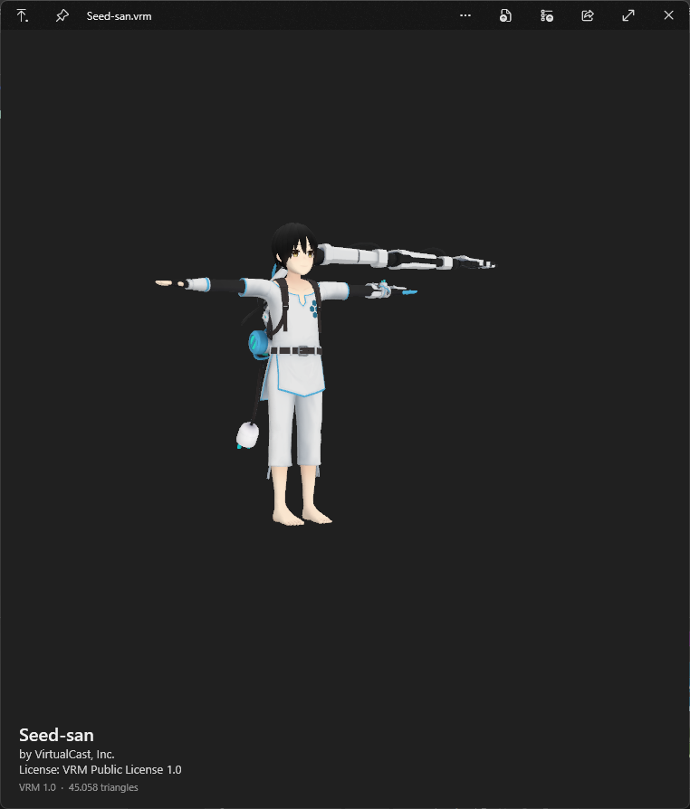

# QuickLook.Plugin.VrmViewer

Previews VRM avatars (`.vrm`) in [QuickLook](https://github.com/QL-Win/QuickLook): select the file, press Space and the model shows up turning around, with its name, author and license underneath.

Model in the screenshot: [Seed-san](https://github.com/vrm-c/vrm-specification/tree/master/samples/Seed-san) by VirtualCast, Inc., VRM Public License 1.0.

- Textured model, all meshes, in the rest pose
- Name, author and license read from the VRM metadata (VRM 0.x and 1.0)
- Drag to orbit, scroll to zoom; grabbing the model stops the turntable
- Large avatars load in the background, so the window stays responsive

Rendering is a quick preview, not a full MToon shader: outlines, rim light and spring bones aren't drawn.

It uses the HelixToolkit library that already ships with QuickLook's built-in 3D viewer, so the plugin itself is a single small DLL.

## Install

Download `QuickLook.Plugin.VrmViewer.qlplugin` from [Releases](../../releases/latest), select it in Explorer, press Space and click "Click here to install this plugin", then "Restart now".

Tested on QuickLook 4.5.0 (Microsoft Store version).

To uninstall, delete the `QuickLook.Plugin.VrmViewer` folder and restart QuickLook. It's in:

- `%APPDATA%\pooi.moe\QuickLook\QuickLook.Plugin\` (installer version)
- `%LOCALAPPDATA%\Packages\21090PaddyXu.QuickLook_egxr34yet59cg\LocalCache\Roaming\pooi.moe\QuickLook\QuickLook.Plugin\` (Store version)

## Build

Needs the .NET SDK. Run `.\pack.ps1`, the plugin ends up in `dist\`.

The DLLs in `lib\` come from a QuickLook 4.5.0 install and are only used to compile: `QuickLook.Common.dll` (GPL-3.0) and `HelixToolkit.dll` / `HelixToolkit.Wpf.dll` (MIT).

## License

GPL-3.0, same as QuickLook.
